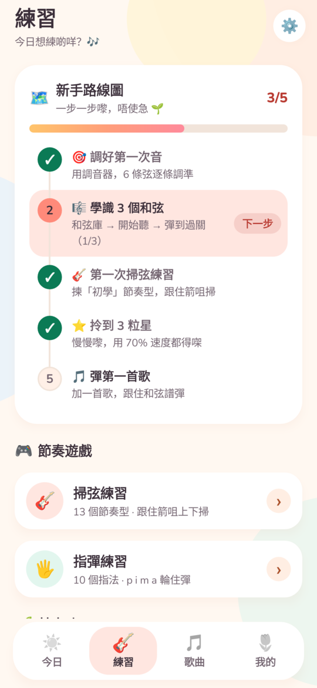
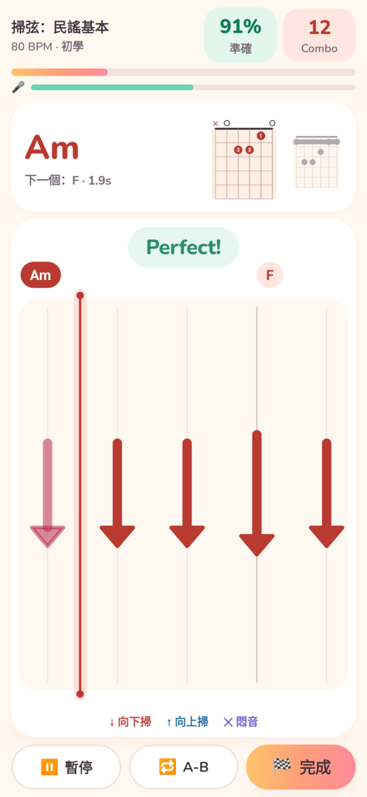
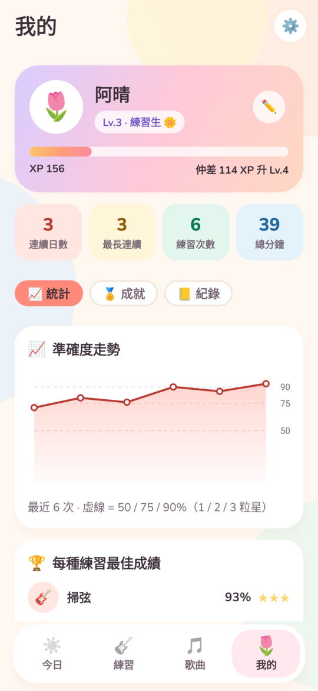

# 🎸 Guitar Trainer（古典結他練習 App）– 項目檔案

古典（尼龍弦）結他練習 App：即時調音、拍子 / 和弦 / 掃弦 / 指彈判定，仲可以分析歌曲。
Android（Kotlin + Jetpack Compose）為主；屋企電腦 server（Python FastAPI）係可選，用嚟做更準嘅歌曲分析。

## 狀態

- **v0.2.0「晨光」UI 改版**：明亮奶油色 + 日出漸變、圓體字、4 個 tab（今日 / 練習 / 歌曲 / 我的）、新手路線圖、每日目標、今日和弦、暱稱問候、新 icon。核心功能（調音、判定、歌曲分析）同 v0.1.0 一樣。設計說明見 [docs/DESIGN.md](docs/DESIGN.md)。
- **v0.1.0**（debug build）已完成；Phase 0 數據驗證完成（GuitarSet + 合成尼龍弦），詳見 [validation/REPORT.md](validation/REPORT.md)。
- 仲有 7 項等你處理（錄音測試、手機延遲、指彈準確度、1 星期實測、手機連 server、20 首歌評估、智能手錶後備），見 [PROGRESS.md](PROGRESS.md)。

## 文件

| 文件 | 內容 |
|---|---|
| [docs/DESIGN.md](docs/DESIGN.md) | UI / UX 設計：色板、字體、畫面、元件、截圖 |
| [docs/BUILD.md](docs/BUILD.md) | Build、安裝、跑 server、跑測試 |
| [docs/ARCHITECTURE.md](docs/ARCHITECTURE.md) | 架構、模組、數據流、關鍵參數、已知限制 |
| [validation/REPORT.md](validation/REPORT.md) | Phase 0 驗證報告 |
| [server/README.md](server/README.md) | 屋企電腦 server 安裝 + 手機設定（Windows / Mac） |
| [PROGRESS.md](PROGRESS.md) | 任務進度表 |

## 項目結構

| 資料夾 | 內容 |
|---|---|
| `android/` | App 原始碼（Kotlin + Jetpack Compose）。Android Studio 開 `android/`，或者 `./gradlew assembleDebug` |
| `server/` | 屋企電腦分析 server（Python FastAPI） |
| `validation/` | Phase 0 驗證腳本 + 結果 JSON + 報告 |
| `docs/` | 架構、build、設計文件；`docs/screenshots/` 畫面截圖 |

## 裝 App

APK 唔入 git（約 32 MB 二進制檔）。取得方法二選一：

1. **自己 build**：`cd android && ./gradlew assembleDebug`，APK 喺 `android/app/build/outputs/apk/debug/app-debug.apk`（詳見 [docs/BUILD.md](docs/BUILD.md)）。
2. **向作者攞** `GuitarTrainer-0.2.0-debug.apk`。

> **由 v0.1.0 升級**：要先刪除舊版（長撳 icon → 解除安裝），因為兩個版本嘅簽名 key 唔同；練習紀錄會清空。v0.2.0 之後嘅版本會直接覆蓋更新。

之後：
1. 將 APK 轉到手機 → 撳開。
2. 第一次會問「允許呢個來源安裝 App」→ 允許（Chrome / Files / Notion 邊個開就允許邊個）。
3. Play Protect 可能話「未知開發者」→ 「仍然安裝」。
4. 開 App → 允許咪高峰 → 先做 **校準**（延遲 + 掃弦方向），再試 **調音器**。

## App 結構（`android/app/src/main/java/com/boss/guitartrainer/`）
- `dsp/` MPM 音高、onset、和弦 chroma、掃弦方向模型、Basic Pitch（TFLite）
- `audio/` AudioRecord / AudioTrack 引擎、節拍機 click、即時分析
- `game/` 判定（Judge）、難度、遊戲 session、校準、成績
- `music/` 和弦庫（50 個指法）、節奏型（strum + 指彈）、Chart 格式、capo / 移調
- `analysis/` 手機本機歌曲分析（MediaCodec 解碼 → 節拍 → 和弦 → key → capo → 分段）
- `net/` 連屋企 server
- `data/` 本機儲存（JSON）、本地日期計連續日數（`Days.kt`）
- `ui/` 所有畫面（Compose）；`Theme.kt` 色板 / 字體 / 共用元件，`Navigation.kt` 4 個 tab

詳細模組同數據流見 [docs/ARCHITECTURE.md](docs/ARCHITECTURE.md)。

## 測試
- App：`cd android && ./gradlew testDebugUnitTest`（22 個 unit tests：DSP、方向模型、判定、樂理、歌曲分析、tempo 同 Python 一致；另加 33 個 Paparazzi 畫面截圖測試）
- 畫面截圖：`cd android && ./gradlew :app:recordPaparazziDebug` → `app/src/test/snapshots/images/`（見 [docs/DESIGN.md](docs/DESIGN.md#7-截圖測試paparazzi)）
- Server：`cd server && python tests/test_pipeline.py`
