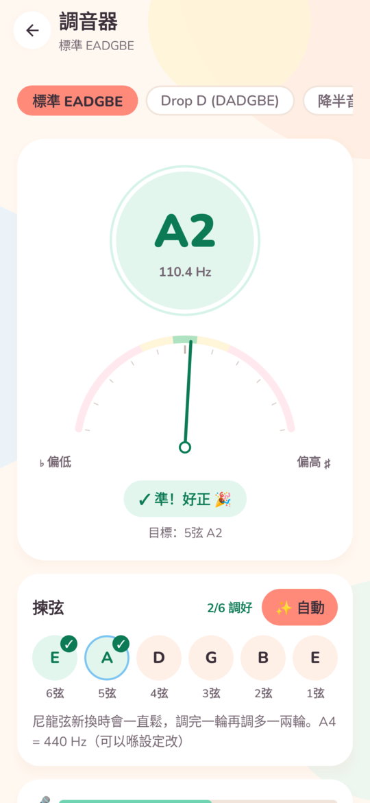
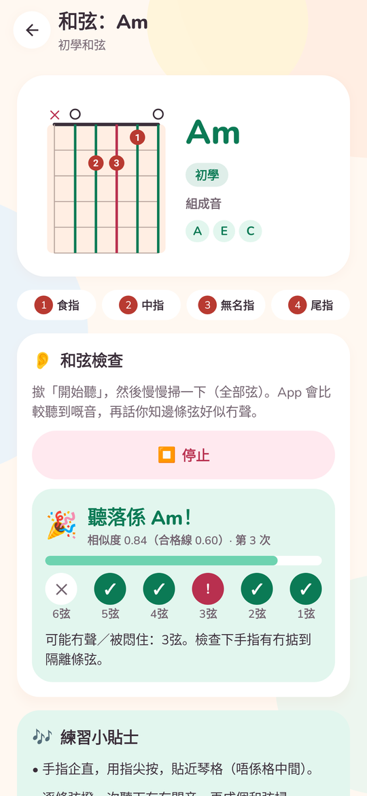
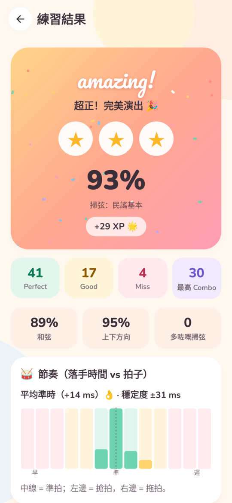
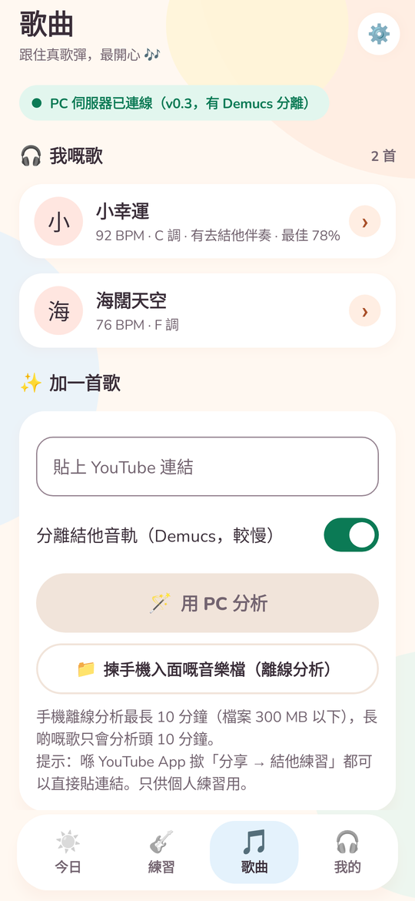
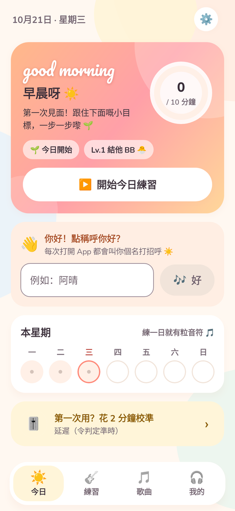
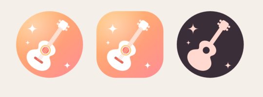

# 🌅 UI / UX 設計說明（v0.2.0「晨光」）

**對象**：啱啱開始學結他嘅女仔 / 初學者。
**感覺**：好似一個明亮嘅早晨——光、清新、chill、有少少驚喜；每日打開都想練多陣。

| 今日 | 練習 | 節奏遊戲 | 我的 |
|---|---|---|---|
|  |  |  |  |
| **調音器** | **和弦** | **練習結果** | **歌曲** |
|  |  |  |  |

## 1. 設計原則

1. **明亮**：奶油紙色底、白色圓角卡、日出漸變（金 → 珊瑚 → 粉紅）。
2. **清新 chill**：薄荷、天空藍、牛油黃、淡紫、玫瑰粉 pastel；唔用刺眼純色。
3. **可愛但唔幼稚**：圓體 Nunito；手寫字 Pacifico 只用喺短英文問候（good morning / amazing!）；emoji 做 icon。
4. **初學者友善**：每個畫面講清楚「下一步做咩」——新手路線圖、今日小目標、每日目標分鐘、今日和弦、小貼士。
5. **有回饋**：撳落有彈性 + 輕震、進度環 / 條動畫、達標彩紙、星星彈出；系統關咗動畫（「移除動畫」）就自動停。

## 2. 色板（`ui/Theme.kt` → `Palette` / `Tone` / `Brushes`）

| 用途 | 色 |
|---|---|
| 底色 Bg | `#FFF8F1`（奶油） |
| 卡 Surface | `#FFFFFF`；淺磚 Surface2 `#FFF0E7` |
| 文字 Text / Muted | `#3A2E39`（梅子啡）/ `#736470` |

每個 `Tone` 有三級：**fill**（pastel，上面用深色字）、**soft**（淺底）、**deep**（可以做文字，對白色 / 奶油 / 自己 soft 底 ≥ 4.5:1）。

| Tone | fill | soft | deep | 主要用途 |
|---|---|---|---|---|
| CORAL | `#FF8A7A` | `#FFE6E0` | `#B83A31` | 主要動作、向下掃 ↓ |
| PEACH | `#FFB48F` | `#FFEEE3` | `#A9502A` | 一般 icon、陰影 |
| SUN | `#FFD36E` | `#FFF5D9` | `#8A5A00` | 星星、XP、提示 |
| MINT | `#6ED3B0` | `#E2F6EE` | `#0B7A55` | 完成、Perfect、調準 |
| SKY | `#7CC4F2` | `#E4F2FC` | `#20679C` | 向上掃 ↑、資訊 |
| LILAC | `#B9A5F2` | `#EFEAFD` | `#6E55C9` | 悶音 ✕、成就、建議 |
| ROSE | `#FF9FB5` | `#FFE9EF` | `#B8304F` | Miss、錯誤 |

漸變：**Sunrise** `#FFC46B → #FF9E7A → #FF8A9B`（主卡、主按鈕）、**Fresh** `#8EE3C3 → #8FD0F5`、**Dreamy** `#D9CCFF → #FFC9D9 → #FFD8C2`（個人檔案）。

## 3. 字體

- **Nunito**（Regular / SemiBold / Bold / ExtraBold / Black）：英文同數字；中文自動用系統 CJK 字型。
- **Pacifico**：裝飾手寫字，只用喺短英文問候。
- 兩隻都係 SIL Open Font License 1.1，見 [licenses/](licenses/)；字型檔喺 `android/app/src/main/res/font/`。

## 4. 導航同畫面

浮起嘅圓角 tab bar，4 個 tab：**今日 / 練習 / 歌曲 / 我的**（揀中嗰個有 pastel 底）。設定喺右上角 ⚙️。

| 畫面 | 重點 |
|---|---|
| 今日 | 按時間問候 + 暱稱、每日目標進度環（達標放彩紙）、連續日數、本星期音符（練一日亮一粒 🎵）、今日小目標、今日和弦、工具、上次練習、小貼士；第一次用有歡迎卡（輸入暱稱） |
| 練習 | 新手路線圖 5 步（調音 → 3 個和弦 → 掃弦 → 3 粒星 → 第一首歌），然後節奏遊戲同工具 |
| 節奏遊戲 | 和弦名 pill、發光判定線；箭咀顏色 = 方向（↓ 珊瑚、↑ 天空藍、✕ 淡紫），判定後變成績色；指彈 tab 有指名（p i m a）|
| 調音器 | 大音名圈、半圓指針、逐條弦打剔、自動揀弦 |
| 和弦 | 和弦圖 + 手指編號、組成音、「開始聽」逐條弦檢查 |
| 結果 | 星星、彩紙、+XP、節奏落手時間分佈、新成就、練習建議 |
| 我的 | Lv / XP、統計磚、準確度走勢、成就（有進度）、練習紀錄 |
| 設定 | 暱稱、每日目標分鐘、原有設定 |

第一次打開：歡迎卡問暱稱，之後每朝都會叫你個名打招呼。



## 5. 元件（`ui/Theme.kt`）

`card()`、`bounceClick()`（彈性 + 輕震）、`morningPaper()`（背景光斑）、`Screen`、`SectionCard`、`IconBubble`、`StatTile`、`BigTile`、`ActionRow`、`PillButton` / `SoftButton` / `GhostButton`、`ChipRow`、`LevelBar`、`ProgressRing`、`AppSlider`（白色珠仔 thumb）、`StepCard`、`Toggle`。新畫面請重用呢啲元件，唔好直接寫顏色。

## 6. App icon

日出漸變底 + 白色結他 + 閃星（adaptive icon，有 monochrome 版本俾 Android 13 主題 icon）。



## 7. 截圖測試（Paparazzi）

```bash
cd android
./gradlew :app:recordPaparazziDebug   # 33 張 → app/src/test/snapshots/images/（唔入 git）
```

測試檔：`app/src/test/java/com/boss/guitartrainer/ui/ScreenshotTest.kt`（唔使手機，用示範數據）。改完 UI 跑一次，睇下有冇爆版；`docs/screenshots/` 係揀出嚟縮細咗嘅版本。
